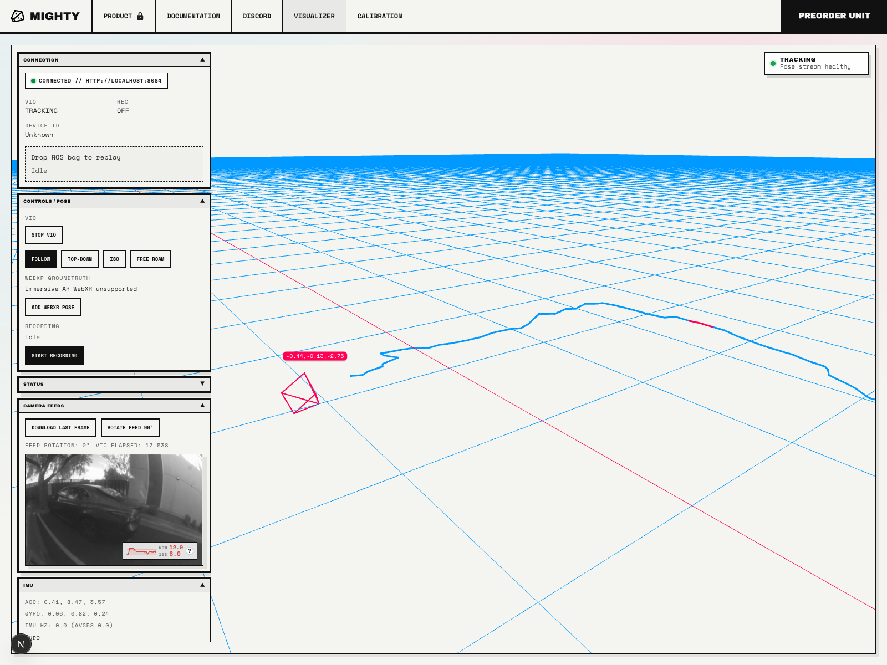
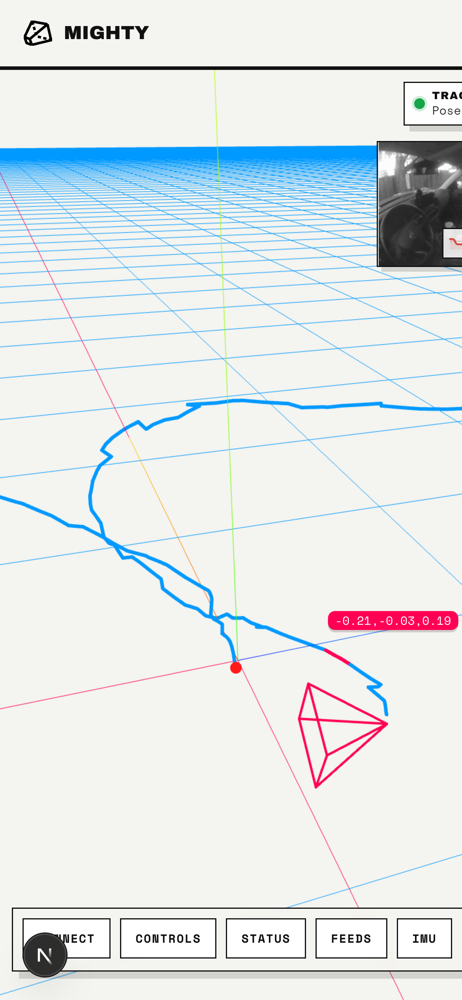

You can test Mighty Camera directly from the browser. The Visualizer Playground
connects to the board and shows live camera, IMU, and VIO data without writing
code or installing a local app.

## Try the visualizer

1. Plug Mighty Camera into your machine.
2. Open Chrome, Chromium, Edge, or Safari.
3. Browse to [mightycamera.com/viz](https://mightycamera.com/viz) and wait for
   the board to connect.
4. Once connected, use the sidebar to inspect live camera and IMU data.
5. Click **Start VIO** to see the board estimate pose in real time.

The visualizer is the quickest way to confirm that the board is connected, the
sensors are streaming, and VIO is running before integrating it into your own
software.

- **Recording:** Expand the **Recording** tab in the sidebar (collapsed by
  default) for browser recording, automatic SD recording with VIO, and SD card
  bag management.
- **SD Card Rosbags (Preview mode):** While in Preview mode (VIO stopped),
  click **SD Bags** to preview a 4-frame montage of recordings on the SD card,
  repair incomplete bags, download, or delete them.

## Board button

The button on Mighty controls **VIO** and **SD card recording** independently,
so you can run both at the same time:

| Button action | Result |
| --- | --- |
| **Short press** (`< 1.2 s`, on release) | Toggle **VIO** (`Start VIO` / `Stop VIO`) |
| **Long press** (`≥ 1.2 s`, fires while held) | Toggle **SD Recording** (`Start` / `Stop`) in Preview or VIO |

See [Recording](/docs/recording) for full recording details, topics, and SD
card management.

## LED states

The board LED shows both VIO health and recording status simultaneously:

| VIO state | Not recording | Recording active |
| --- | --- | --- |
| **Preview / Idle** | Slow single blip | Triple blip, pause |
| **VIO Tracking** | Solid ON | Solid ON + double shutter wink |
| **VIO Starting / Recovering** | Fast even blink | Fast triple burst, pause |
| **VIO Degraded / Low Light** | Double blip | Double blip + recording pulse |
| **VIO Lost** | Steady medium blink | Steady medium blink (Lost always wins) |

## Mobile and tablet

Mighty also works from a phone or tablet because the board includes its own web
server and visualizer. This is useful when testing on the go without carrying a
laptop.

1. Plug Mighty Camera into your iOS or Android device over USB.
2. Turn off Wi-Fi on the phone or tablet so the browser uses the USB network
   connection to Mighty.
3. Open the browser and visit [http://192.168.7.1](http://192.168.7.1).

