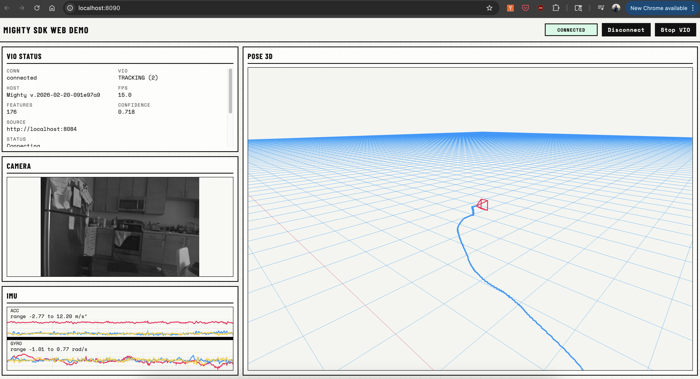

# Web Example (Vanilla JS + Vite)

This example shows SDK usage in plain browser JS using npm modules:
- `dashboard/`: SDK/device/client usage
- `mapper/`: live WASM mapper with a Three.js view matching the Pangolin mapper style
- `loopclosure/`: loop-closure WASM usage
- `shared/`: UI rendering helpers and shared styling

## Preview



Dependencies:
- `mighty-protocol` from local path (`file:../..`)
- `three` from npm
- Vite for dev server

## Run

From the `mighty-protocol/examples/web` directory:

```bash
npm install
npm run dev
```

Open the local URL printed by Vite (default `http://localhost:8090`).

Dashboard page:

```text
http://localhost:8090/dashboard/
```

Mapper page:

```text
http://localhost:8090/mapper/
```

Loop-closure page:

```text
http://localhost:8090/loopclosure/
```

Connect Mighty Camera and start VIO in the visualizer to view its live stream.

## Notes

- The mapper page prefers `http://localhost:8084`, then `http://localhost:8080`, then the device default.
- If your device host differs, update `vite.config.js` proxy target or pass explicit hosts in code.
- Mapper WASM updates are keyframe replacements. Consume `update.frames` from
  `NativeMapperWasm.onMapUpdate()` or use `onMapFrameUpdate()`.
